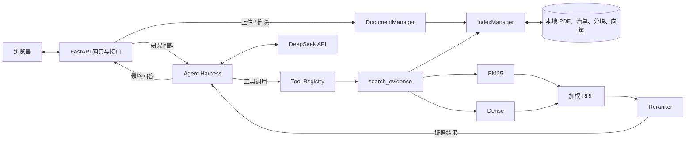

# 🔎 EvidenceScope

**让本地 PDF 问答回到可核对的原文。**

EvidenceScope 是一个多文档研究 Agent：用户在网页上传 PDF、提出问题，Agent 根据当前文档目录选择检索范围，调用混合检索工具寻找证据，再用文件名、PDF 页码和 Chunk ID 标出回答依据。它关注的不只是生成答案，还有证据如何被找到、传给模型并供人核对。

<sub>EvidenceScope is a local PDF research agent with hybrid retrieval, tool calling, and traceable evidence.</sub>

`Python` · `FastAPI` · `DeepSeek API` · `BM25` · `BGE Embedding` · `RRF` · `BGE Reranker`

[✨ 功能预览](#功能预览) · [💡 设计亮点](#设计亮点) · [🧭 系统架构](#系统架构) · [🚀 快速开始](#快速开始) · [⚠️ 当前限制](#当前限制)

> PDF 和索引保存在运行本项目的电脑上；问题与检索返回的原文会发送给 DeepSeek API。请在上传敏感资料前确认这符合你的使用要求。

## ✨ 功能预览

一次典型使用：**上传可提取文字的 PDF → 在网页提问 → 查看带来源信息的回答**。例如，上传自己的年报后，可以询问“这份报告披露的营业收入是多少？依据在哪一页？”回答由当前可用的文档证据生成，没有预置答案。

| 能力 | 实际行为 |
| --- | --- |
| 💬 网页研究 | 提交问题、查看回答及其文本引用；服务提供本地 FastAPI 接口 |
| 📁 文档管理 | 上传、列出、删除 PDF；校验文件类型、大小、可提取文字及重复内容 |
| 🔎 多文档检索 | Agent 获得当前文档目录，可指定文件检索，也可全库发现或分别检索多份文件 |
| 🎯 证据排序 | BM25 与 Dense 各自召回，按加权 RRF 融合，随后用 Cross-Encoder 重排候选 |
| 📍 来源追溯 | 工具返回原文、文件名、页码和 Chunk ID；提示词要求最终答案引用实际使用的证据 |
| 🔄 索引同步 | PDF 新增、修改或删除后同步文档清单和分块；向量按文档独立存储 |

## 💡 设计亮点

**混合检索应对两类问题。** 年报等资料中的名称、指标和数字常常需要精确匹配，BM25 能保留这些关键词线索；用户的问题也可能换一种说法，Dense 检索为语义相近的内容提供另一条召回路径。当前采用 `jieba + rank-bm25` 和 `BAAI/bge-small-zh-v1.5`，没有假定单一路径始终更好。

**先融合排名，再细读候选。** BM25 与 Dense 的原始分数不可直接比较，因此用加权 RRF 融合各自排名；工具再把融合候选交给 `BAAI/bge-reranker-base`，让 Cross-Encoder 同时阅读“问题—片段”对并重排。代码中的默认权重为 BM25 `1.5`、Dense `1.0`；这是当前配置，不代表对所有语料的最优结论。

**Agent 负责选择与迭代，检索器负责找证据。** `AgentHarness` 将文档目录加入每个问题的上下文，调用 DeepSeek 的工具接口，执行 `search_evidence`，把结果回填给模型，并限制最大迭代次数。工具按可选的 `source` 参数选择单份文档或整个知识库；证据不足时，模型可以换查询再次检索。

**证据与索引都可定位。** 检索结果保留文件名、PDF 页码、Chunk ID 和原文，让读者能够回查；索引按文档拆分，`manifest.json` 记录文档状态。新增或修改 PDF 时只重建需要更新的分块，文档变化还会使内存检索器缓存失效。

## 🧭 系统架构



浏览器把问题交给 FastAPI；Harness 将文档目录与问题发给模型，并执行模型选择的检索工具。工具同步本地索引、确定文档范围、融合两路召回并重排，随后把证据返回 Harness。模型据此形成回答，再由网页展示。模型可以在一次问题中多次调用工具，并非每个问题只检索一次。

## 🛠️ 技术栈

| 组件 | 技术与职责 |
| --- | --- |
| 网页与接口 | HTML、CSS、原生 JavaScript；FastAPI 提供页面、上传、文档管理和问答接口 |
| Agent 与模型 | Python、OpenAI 兼容 SDK、`deepseek-chat`；Harness 处理工具调用和结果回填 |
| PDF 与索引 | PyMuPDF 提取文本；JSON 保存清单与分块，NumPy 文件保存每份文档的向量 |
| 召回与重排 | `jieba`、`rank-bm25`、Sentence Transformers、BGE Embedding 与 BGE Reranker |

## 📂 项目结构

```text
evidence_scope/
├── main.py                  # CLI 入口、系统提示词、Agent 组装
├── api.py                   # FastAPI 页面与 HTTP 接口
├── document_management.py   # 上传、校验、删除 PDF
├── agent/                   # Harness 与工具注册
├── tools/evidence_search.py # Agent 调用的检索工具
├── retrieval/               # 分块、索引、BM25、Dense、RRF、重排
├── static/                  # 网页资源
├── tests/                   # 文档接口测试
└── data/
    ├── documents/          # PDF；随仓库保留
    └── indexes/            # 索引目录保留；分块和向量在本机生成
```

可从 [Agent Harness](agent/harness.py)、[检索工具](tools/evidence_search.py) 和 [索引管理](retrieval/index_manager.py) 继续阅读实现。

## 🚀 快速开始

以下示例使用 **Windows PowerShell**，在 EvidenceScope 项目目录执行。建议 Python 3.12；安装依赖、下载模型以及调用 DeepSeek API 都需要网络连接。

1. **进入项目并安装依赖**

   ```powershell
   python -m venv .venv
   .\.venv\Scripts\python.exe -m pip install -r requirements.txt
   ```

2. **配置自己的 DeepSeek API Key**

   ```powershell
   Copy-Item .env.example .env
   ```

   在 `.env` 中将 `DEEPSEEK_API_KEY` 的示例值替换为自己的密钥。项目通过 `python-dotenv` 读取它；`.env` 已被 Git 忽略，请勿提交。

3. **准备本地检索模型**

   ```powershell
   .\.venv\Scripts\python.exe -c "from huggingface_hub import snapshot_download; snapshot_download('BAAI/bge-small-zh-v1.5'); snapshot_download('BAAI/bge-reranker-base')"
   ```

   Embedding 优先使用本地缓存，缺失时会尝试下载；Reranker 当前要求模型已在本地缓存。首次下载和载入需要时间、磁盘空间，且须能访问 Hugging Face。

4. **启动并使用网页**

   ```powershell
   .\.venv\Scripts\python.exe -m uvicorn api:app --host 127.0.0.1 --port 8000
   ```

   打开 <http://127.0.0.1:8000/>，在“管理 PDF”上传一份可提取文字的 PDF，然后输入研究问题。上传会建立分块索引；首次检索新文件时还可能需要计算向量。也可以在项目目录运行 `.\.venv\Scripts\python.exe main.py` 使用命令行入口。

## 🔁 一次问题如何完成

1. Harness 把当前文档目录和问题交给模型；目录用于挑选文件，不作为文档事实证据。
2. 模型调用 `search_evidence`，可给出具体查询和目标文件；工具先同步 PDF 与索引。
3. BM25、Dense、加权 RRF 和 Reranker 得到候选原文，工具附上文件名、页码与 Chunk ID。
4. Harness 将工具结果回填给模型；模型可继续检索，或依据已有证据回答。
5. 网页展示最终文本，用户依据所列来源核对原 PDF。

## ⚠️ 当前限制

- 需要使用者自己的 DeepSeek API Key；调用模型会产生外部服务费用，项目尚未提供离线回答模式。
- PDF 必须可提取足够文字，上传大小上限为 50 MB；扫描件没有 OCR，复杂表格的文本顺序也可能影响检索。
- 文件名、页码和 Chunk ID 来自检索结果，但最终引用由模型写出；当前没有独立的程序化证据支持性校验，重要结论需要人工复核。
- 服务按本地单机使用设计，示例仅监听 `127.0.0.1`；没有账号、用户隔离或公网部署方案。每次提问独立处理，不保存跨问题对话历史。
- 企业年报是主要使用案例，不能据此推断其他类型资料具有相同检索表现；本仓库也未提供打包好的桌面安装程序。

## 🗺️ 后续方向

以下是计划，不属于当前已实现功能：增加回答与证据的一致性检查；扩充不同文档类型的检索评测；改善首次模型准备和分发体验。

## 📜 许可与致谢

仓库目前没有 `LICENSE` 文件，因此本 README 不声明开源许可证。项目使用 DeepSeek API，以及 FastAPI、PyMuPDF、rank-bm25、Sentence Transformers 和 BAAI 发布的 BGE 模型；使用与再分发时应分别遵循它们各自的条款。
