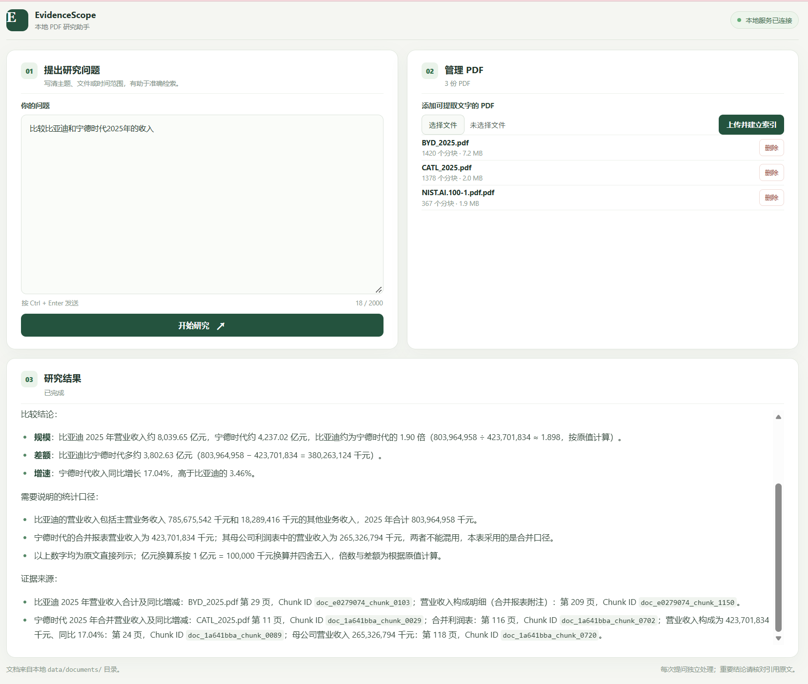
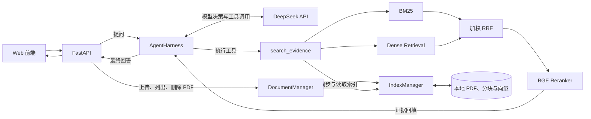

<div align="center">


# EvidenceScope

### 让本地 PDF 研究有据可查

面向本地 PDF 的 AI Agent：由模型调用检索工具，找到相关原文，并在回答中给出可回查的来源。

**上传 PDF → 提出问题 → 检索证据 → 核对原文**

[核心功能](#核心功能) · [技术亮点](#技术亮点) · [系统架构](#系统架构) · [快速开始](#快速开始) · [当前限制](#当前限制与后续方向)

🟢 `Python` &nbsp; 🔵 `FastAPI` &nbsp; 🟣 `DeepSeek API` &nbsp; 🟠 `BM25 + Dense` &nbsp; 🟢 `BGE Reranker`

</div>

> [!IMPORTANT]
> PDF 和索引保存在运行项目的电脑上；问题与检索返回的原文会发送给 DeepSeek API。回答中的引用由模型生成，重要结论请回到原 PDF 核对。

<div align="center">
  
  <br>
  <sub>实际运行界面：提问、管理 PDF，并查看带来源信息的回答。截图仅作功能演示，结论仍需核对原文。</sub>
</div>

## 核心功能

| 能力 | 实际行为 |
| --- | --- |
| **📁 文档管理** | 在网页上传、查看和删除 PDF；校验类型、大小、可提取文字及重复内容，单文件上限 50 MB |
| **🔄 索引同步** | 为新增或变化的 PDF 更新分块，删除文档时移除索引；向量按文档保存 |
| **🤖 Agent 工具调用** | 模型选择 `search_evidence` 的查询和文档范围，读取结果后可继续检索，最多执行 8 轮 |
| **🔎 混合检索** | BM25 与 Dense Retrieval 分别召回，经加权 RRF 融合、BGE Reranker 重排 |
| **📍 来源追溯** | 检索工具提供原文、文件名、PDF 页码和完整 Chunk ID，供回答引用及人工回查 |

## 技术亮点

### 01 · 🤖 Agent 管理检索过程

`AgentHarness` 发起模型调用、执行模型请求的工具、把结果加入对话，并控制迭代次数。文档目录帮助模型选择文件；检索到的原文才是回答事实问题的依据。

### 02 · 🔎 两条召回路径互补

BM25 适合匹配名称、数字和术语等明确词汇；基于 BGE Embedding 的 Dense Retrieval 用语义相似度寻找不同表述的片段。两路结果共同提供候选，减少对单一匹配方式的依赖。

### 03 · 🎯 融合与重排分工明确

BM25 与 Dense 的原始分数不直接相加；加权 RRF 根据各自排名合并候选，随后 BGE Reranker 同时读取问题与候选原文，重新排序相关片段。当前权重为 BM25 `1.5`、Dense `1.0`，不代表对所有文档都最优。

### 04 · 📍 文档变化可同步，证据可定位

`IndexManager` 用清单记录文档状态，只重新分块需要更新的文件，并使变化文档的向量失效。文档目录变化也会清除检索缓存。来源、页码与 Chunk ID 有助于定位原文，但回答与证据是否一致仍需人工核对。

## 系统架构



模型可在一次提问中多次调用 `search_evidence`。文档管理由 FastAPI 调用 `DocumentManager`；检索工具通过 `IndexManager` 同步和读取本地索引。

## 快速开始

以下示例适用于 Windows PowerShell。先安装 Python 3.12，并确认下面的命令能找到它；安装依赖和下载模型需要网络连接。

**1. 创建环境并安装依赖**

```powershell
py -3.12 --version
py -3.12 -m venv .venv
.\.venv\Scripts\python.exe -m pip install -r requirements.txt
```

如果系统没有 `py` 命令，可用已安装的 Python 3.12 解释器运行 `-m venv .venv`。若已有可用的 Python 3.12 虚拟环境，可跳过创建步骤，并用该环境的 `python` 安装依赖和执行后续命令。

**2. 配置 DeepSeek API Key**

```powershell
Copy-Item .env.example .env
```

在 `.env` 中填入自己的 `DEEPSEEK_API_KEY`。该文件已由 `.gitignore` 排除，请勿提交。

**3. 下载模型并启动**

Reranker 需要已缓存的模型才能运行：

```powershell
.\.venv\Scripts\python.exe -c "from huggingface_hub import snapshot_download; snapshot_download('BAAI/bge-small-zh-v1.5'); snapshot_download('BAAI/bge-reranker-base')"
.\.venv\Scripts\python.exe -m uvicorn api:app --host 127.0.0.1 --port 8000
```

> [!NOTE]
> **首次运行需要等待：**安装命令会下载 Python 依赖；模型命令会从 Hugging Face 下载 `BAAI/bge-small-zh-v1.5` 和 `BAAI/bge-reranker-base`，并占用额外磁盘空间。首次同步 PDF 索引、生成向量或加载模型时，响应可能比后续查询慢。若模型下载失败，请先查看 PowerShell 中的报错，检查是否能访问 Hugging Face，以及网络代理和模型缓存目录的读写权限；修复后重新运行模型下载命令。磁盘占用取决于实际下载的文件，本项目未提供固定数值。

浏览器打开 <http://127.0.0.1:8000/>。仓库已附带 `BYD_2025.pdf`、`CATL_2025.pdf` 和 `NIST.AI.100-1.pdf.pdf`，无需先上传文件即可提问；也可以上传自己的可提取文字的 PDF。命令行入口为 `.\.venv\Scripts\python.exe main.py`。

### 示例问题

可以直接复制到网页中试用：

- 根据 `NIST.AI.100-1.pdf.pdf`，GOVERN 为什么是跨领域功能？请列出依据所在的 PDF 页码和 Chunk ID。
- 比较 `BYD_2025.pdf` 与 `CATL_2025.pdf` 中披露的 2025 年营业收入，并分别给出原文位置。
- 在 `CATL_2025.pdf` 中查找营业收入同比变化的依据，返回相关页码和 Chunk ID。

## 项目目录

```text
evidence_scope/
├── api.py                    # FastAPI 页面、文档管理和问答接口
├── main.py                   # Agent 组装、系统提示词与命令行入口
├── document_management.py    # PDF 上传、校验、删除
├── agent/                    # AgentHarness 与工具注册
├── tools/evidence_search.py  # 证据检索工具
├── retrieval/                # 分块、索引、BM25、Dense、RRF、重排
├── static/                   # 网页 HTML、CSS、JavaScript
├── data/documents/           # 本地 PDF，当前仓库包含示例文档
├── data/indexes/             # 运行时生成的索引，内容不提交
├── requirements.txt          # Python 依赖
└── .env.example              # API Key 配置示例
```

## 技术栈

| 技术 | 用途 |
| --- | --- |
| FastAPI、HTML/CSS/JavaScript | 本地网页与 HTTP 接口 |
| OpenAI 兼容 SDK、DeepSeek API | 模型调用与工具决策 |
| PyMuPDF | PDF 文本提取与分页分块 |
| jieba、rank-bm25 | 中文分词与关键词召回 |
| Sentence Transformers、BGE Embedding | 语义向量召回 |
| 加权 RRF、BGE Reranker | 候选融合与重排 |
| JSON、NumPy | 文档清单、分块和向量存储 |

## 当前限制与后续方向

- 项目按本地单机使用设计，启动示例仅监听 `127.0.0.1`；没有账号、用户隔离或公网部署方案。调用 DeepSeek API 需要使用者自己的密钥，并可能产生费用。
- PDF 需能提取足够文字；目前没有 OCR。复杂表格的提取顺序可能影响检索，过短的页面不会进入索引。
- 文件名、页码和 Chunk ID 来自检索结果，但最终引用由模型生成；项目尚未程序化验证每项结论是否受到引用原文支持，重要结论应人工复核。
- 后续可增加回答与证据的一致性检查，并用不同类型文档评估检索表现。
